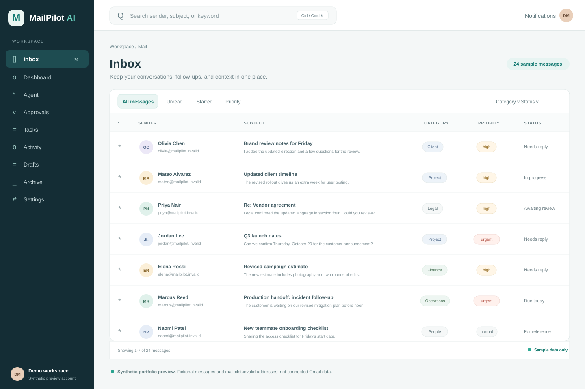
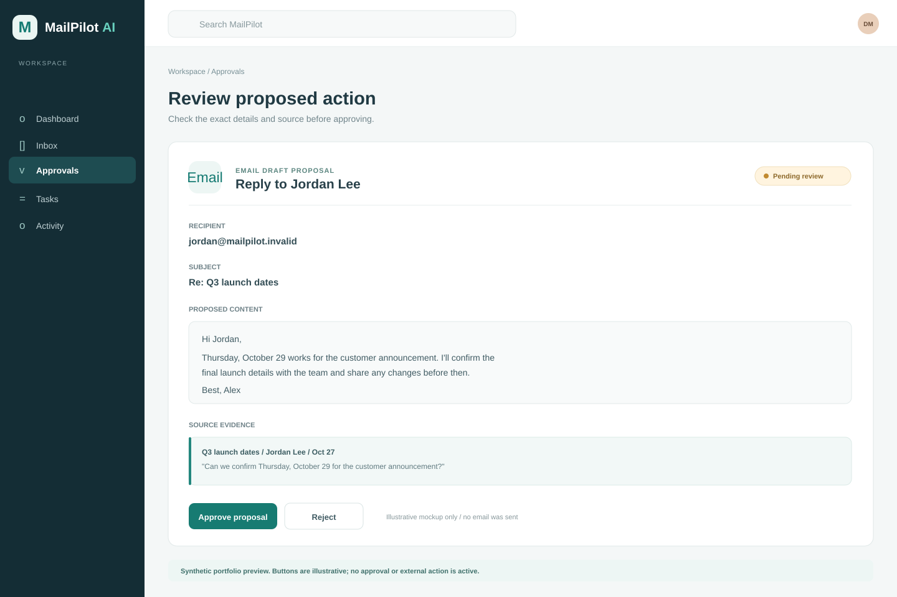
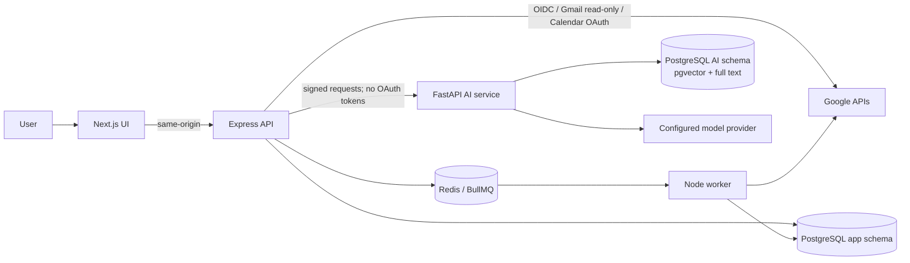

# MailPilot AI

MailPilot AI is a privacy-minded email assistant. It supports application sign-in through Google OpenID Connect with database-backed sessions, read-only Gmail synchronization, owner-scoped structured email analysis, evidence-linked reply suggestions, grounded historical email answers, source-linked tasks, persisted action approvals, and optional Google Calendar connection. Calendar event creation requires an approved exact proposal and is disabled by default. Reply suggestions remain editable and cannot be sent; Gmail sending is not implemented.

## Portfolio overview

MailPilot explores how an assistant can find decisions, dates, and commitments in long email threads while keeping identity, mailbox access, and consequential actions behind explicit service boundaries. The repository includes a synthetic preview workspace; it is not a public production service, and the preview inbox is not connected Gmail data.



*Illustrative portfolio mockup based on the synthetic UI data. It is not a capture from a running app or a connected Gmail inbox; see the [HTML source](docs/screenshots/mailpilot-inbox-preview.html).*



*Approval preview uses fictional content and is not an active or executed proposal.*

### System map



The browser presents the UI; Express owns identity, user scoping, Google credentials and provider effects; FastAPI owns model orchestration and retrieval without Gmail tokens. PostgreSQL is the system of record, and Redis carries background jobs. See [architecture](docs/architecture.md) and [deployment architecture](docs/deployment-architecture.md).

**Technology choices:** Next.js/React/TypeScript for the typed UI and contracts; Express/TypeScript for OAuth and data ownership; FastAPI/Python for model and retrieval tooling; PostgreSQL/pgvector plus full-text search for exact and semantic lookup; LangGraph for explicit bounded workflow nodes; scikit-learn for an experimental reproducible baseline; Redis/BullMQ for sync jobs.

### Demo and interview notes

The [3–4 minute demo script](docs/portfolio-demo.md) uses synthetic preview data and skips live AI generation when a provider is not configured. The [interview guide](docs/portfolio-interview-guide.md) covers service boundaries, embeddings, hybrid RAG, LangGraph, the classifier, approval safeguards, and trade-offs.

## Architecture

- `apps/web`: Next.js App Router, TypeScript, Tailwind CSS. Browser UI; no provider credentials.
- `apps/api`: Express and TypeScript. Public API boundary, Google OIDC application sign-in, separate Gmail read-only and Calendar OAuth, owner-scoped Gmail sync jobs, email analysis and reply-suggestion persistence, persisted approvals, approval-gated Calendar event creation, and dependency readiness checks. A separate Node worker dispatches durable jobs through BullMQ.
- `apps/ai`: FastAPI and Python. AI service health, provider-neutral LLM and embedding contracts, structured email analysis, evidence-validated reply suggestions, and a persistent, read-only LangGraph RAG workflow with bounded intent planning and owner-scoped search/answer tools.
- `packages/shared`: TypeScript types and Zod runtime schemas shared by web and API.
- `prisma/`: stable Prisma ORM 7 schema and initial migration. PostgreSQL is local system-of-record infrastructure; `vector` extension is created in the initial migration.
- `docs/`: approved architecture, contracts, data model, security, evaluation, and roadmap.

The proposed first-hosted topology, platform/cost rationale, deployment diagram, migration and rollback order, backup policy, OAuth URLs, and operator recovery procedures are in [docs/deployment-architecture.md](docs/deployment-architecture.md). It also lists the repository prerequisites that must be closed before deploying real mailbox data.

The Render Blueprint, GitHub CI and protected deployment workflow, production secrets/roles, ordered migration procedure, health checks, and rollback instructions are in [docs/ci-cd-production.md](docs/ci-cd-production.md).

Application and package versions are exact-pinned in `package.json` and `apps/ai/pyproject.toml`; `package-lock.json` and `apps/ai/uv.lock` pin transitive dependencies. Version selection and local requirements are documented in [docs/engineering-setup.md](docs/engineering-setup.md).

Python service development and dependency updates are documented in [apps/ai/README.md](apps/ai/README.md).
The initial embedding model and adapter limits are documented in [docs/embedding-provider.md](docs/embedding-provider.md).
The read-only RAG StateGraph and its Mermaid visualization are documented in [docs/rag-workflow.mmd](docs/rag-workflow.mmd).
Checkpoint identity, resume behavior, graph traces, and failure recovery are documented in [docs/agent-workflow-persistence.md](docs/agent-workflow-persistence.md).
Google Calendar setup, OAuth separation, time-zone validation, approval requirements, idempotency, and reconciliation are documented in [docs/calendar-integration.md](docs/calendar-integration.md).
Phase 12.2 adds opt-in, owner-scoped memory management, source provenance, correction/expiry/deletion controls, and a bounded lexical retrieval preview in Settings. Memory values are not yet sent to email analysis or the LangGraph workflow. See [docs/memory-design.md](docs/memory-design.md).
Phase 12.3 moves Gmail synchronization to a durable Node worker with Redis/BullMQ, a PostgreSQL transactional outbox, bounded retries, and persisted failure records. See [docs/background-jobs.md](docs/background-jobs.md).

## Manual prerequisites

1. Node.js **22.13 or later on the 22.x line** and npm **10.9 or later**. The current ESLint 10 and Prisma 7 toolchain needs a supported modern Node runtime.
2. Python **3.12.x** and `uv` **0.12.18** ([official installation instructions](https://docs.astral.sh/uv/getting-started/installation/)).
3. Docker Desktop with Docker Compose v2, started and available on PATH. Docker is not installed in every development environment; without it, PostgreSQL health readiness will stay unavailable unless a compatible local PostgreSQL server with pgvector is provided.
4. Network access to npm and Python package registries for a first install. Provider calls require `OPENAI_API_KEY`; mocked tests and health routes do not.
5. Host ports **3000**, **4000**, **8000**, **55432**, and **56379** must be available. Compose publishes PostgreSQL and Redis only on loopback; their ports avoid the conventional local PostgreSQL and Redis ports.
6. To test real sign-in and Gmail connection, configure the separate Google OAuth clients described in [docs/google-cloud-setup.md](docs/google-cloud-setup.md). Application sign-in requests only `openid email`; Gmail authorization separately requests the read-only Gmail scope. Server-to-server analysis and reply drafting require a shared local `AI_SERVICE_TOKEN` and an `OPENAI_API_KEY` for FastAPI.
7. To connect Calendar, follow [docs/calendar-integration.md](docs/calendar-integration.md) to create a separate OAuth client and configure its encryption key. Leave `GOOGLE_CALENDAR_EVENTS_ENABLED=false` while testing connection and proposal approval. Provider event creation is off by default.

## Setup

From the repository root in PowerShell:

```powershell
Copy-Item .env.example .env
npm ci
uv sync --project apps/ai --locked
npm run db:up
docker compose ps
npm run db:generate
npm run db:deploy
npm run db:ai:migrate
npm run db:seed
```

`db:up` starts only PostgreSQL; the three application services run as local development processes. Wait until `docker compose ps` reports the database as `healthy` before running migrations. Compose-managed named storage retains database files across container restarts and `npm run db:down`.

The example `.env` values are local-only placeholders. Do not use them outside a developer machine. The file is ignored by Git. `DATABASE_URL` must use the same database name, username, password, and host port as the Compose settings.

Application pages require an active session. Sign-in creates a new random session token, stores only its SHA-256 hash in PostgreSQL, and sets an HttpOnly cookie. The API checks expiry and revocation on each protected request; sign-out revokes the session. Production cookies use the `__Host-` prefix, `Secure`, `HttpOnly`, and `SameSite=Lax`. The CSRF cookie is `SameSite=Strict` and is checked with the request Origin on writes.

The seed command is explicit and local-development-only. It refuses any target other than the loopback `mailpilot` database on port `55432` and inserts one synthetic user with an `.invalid` address. It never clears existing data and does not create Gmail accounts, credentials, or messages. Prisma ORM 7 runs seed scripts only when `prisma db seed` is invoked explicitly.

## Database integration tests

The normal unit suite skips PostgreSQL integration tests unless `DATABASE_TEST_URL` is set. To run the real connectivity and migration checks against a dedicated local database:

```powershell
Copy-Item .env.test.example .env.test
docker compose exec -T db createdb -U mailpilot mailpilot_test
npm run test:db
```

The integration test accepts only a loopback PostgreSQL URL for database `mailpilot_test` on port `55432`. Each run resets that test database, applies the checked-in migrations, verifies a Prisma adapter query, and performs a synthetic user read/write round trip. Do not point `DATABASE_TEST_URL` at a development or production database.

## Run all applications

```powershell
npm run dev:all
```

Or run each in its own terminal:

```powershell
npm run dev:web
npm run dev:api
npm run dev:worker
npm run dev:ai
```

The web, API, and AI service listen at `http://localhost:3000`, `http://localhost:4000`, and `http://localhost:8000`. `npm run db:up` starts PostgreSQL and Redis; wait for both containers to become healthy before launching services. `npm run dev:all` starts the web app, API, Node background worker, and AI service. Sync requests now enqueue work and the settings page polls for progress. Press Ctrl+C to stop all processes.

The worker can also run separately with `npm run dev:worker`. Do not run multiple copies of the worker in watch mode against the same source tree.

## Health checks

| Component | URL | Expected when dependencies are ready |
|---|---|---|
| Web liveness | `http://localhost:3000/api/health` | HTTP 200, JSON `{ "service": "web", "status": "ok", "requestId": "..." }` |
| Express liveness | `http://localhost:4000/health/live` | HTTP 200, JSON status `ok` |
| Express readiness + PostgreSQL/Redis/worker | `http://localhost:4000/health/ready` | HTTP 200 only when PostgreSQL and Redis respond and at least one Node worker heartbeat is current; otherwise HTTP 503 with safe status |
| FastAPI liveness | `http://localhost:8000/internal/v1/health/live` (`/health/live` alias) | HTTP 200, JSON status `ok` |
| FastAPI readiness + PostgreSQL | `http://localhost:8000/internal/v1/health/ready` (`/health/ready` alias) | HTTP 200 only when `SELECT 1` succeeds; otherwise HTTP 503 with safe status |
| PostgreSQL/pgvector | `docker compose exec db pg_isready -U mailpilot -d mailpilot` | `accepting connections`; `SELECT extname FROM pg_extension WHERE extname = 'vector';` returns `vector` after migrations. Host port `55432` avoids a local PostgreSQL service on `5432`. |
| Redis/BullMQ | `docker compose exec redis redis-cli ping` | `PONG`; Redis uses AOF persistence, `noeviction`, and host port `56379`. |

Use `npm run db:up`, `npm run db:down`, and `npm run db:logs` to manage the local database.

## Troubleshooting

- **Docker command not found or daemon unavailable:** install/start Docker Desktop with Compose v2, then check `docker info` and `docker compose version`.
- **Database stays unhealthy:** inspect `docker compose ps` and `docker compose logs --tail=100 db`; confirm port `55432` is available and `.env` database settings match `.env.example`.
- **API or AI readiness returns 503:** confirm PostgreSQL is healthy, `DATABASE_URL` points to `localhost:55432`, and the database is accepting connections. Then run `npm run db:deploy` if this is a new database.
- **Database reports the wrong password after changing `.env`:** the named volume retains the original PostgreSQL initialization. Keep the original local credentials or deliberately recreate the local database volume; recreating it deletes its stored data.
- **A service port is occupied:** stop the process using port `3000`, `4000`, `8000`, or `55432`, then restart the affected service.
- **Python dependency sync says the lock is stale:** update the exact pin in `apps/ai/pyproject.toml`, run `uv lock --project apps/ai`, then retry `uv sync --project apps/ai --locked`.

## Quality checks

```powershell
npm run lint
npm run typecheck
npm test
npm run build
npm run db:validate
```

Focused commands:

```powershell
npm run lint:ts
npm run lint:py
npm run typecheck:ts
npm run typecheck:py
npm run test:ts
npm run test:py
```

TypeScript unit tests use Vitest. Python tests use pytest with HTTPX's async ASGI transport; external providers and PostgreSQL checks are mocked in unit tests. Health readiness must be checked against the local Compose database for the full integration check.

## Repository guidance

Read [AGENTS.md](AGENTS.md) before making changes. See [docs/architecture.md](docs/architecture.md) for service ownership and [docs/roadmap.md](docs/roadmap.md) for the next implementation phases.

## Portfolio evidence and limitations

The recorded values below are offline synthetic fixture measurements, not production or real-mailbox benchmarks. Full methodology and per-class results are in [docs/evaluation.md](docs/evaluation.md).

### Hybrid retrieval replay

Seven hand-labeled queries compare vector candidate ranks with keyword/vector Reciprocal Rank Fusion (RRF, rank constant 60). The cases cover exact names, dates, invoice references, paraphrases, a no-answer query, and a foreign-owner distractor.

| Metric | Vector only | Hybrid RRF |
|---|---:|---:|
| Recall@1 | 0.3333 | 1.0000 |
| Precision@1 | 0.2857 | 0.8571 |
| MRR | 0.4762 | 0.8571 |
| Recall@3 | 1.0000 | 1.0000 |
| Precision@3 | 0.2857 | 0.2857 |

Citation correctness, citation coverage, faithfulness, and abstention precision/recall each scored 1.0 on six hand-authored supported claims and one expected abstention; no generated answer was evaluated. Rank-selection timing over 500 repeats and seven cases was 0.0007/0.0008 ms p50/p95 for vector and 0.0039/0.0044 ms for hybrid. It excludes embeddings, PostgreSQL, network, and model latency. No reranker was added.

### Experimental email classifier

The synthetic dataset is split by thread/duplicate group: 18 train, 9 validation, and 9 held-out test messages. TF-IDF + Logistic Regression scored 55.6% category accuracy / 51.9% macro-F1 and 55.6% priority accuracy / 41.3% macro-F1. The train-only majority baseline scored 11.1% / 2.2% for category and 22.2% / 9.1% for priority.

Each category has one held-out test example, so these figures are exploratory and the classifier is not in the application request path. Local in-process prediction latency was 1.095 ms p50 / 2.113 ms p95 with the model already loaded; it excludes startup, API/network time, and production load. The LLM comparison produced no valid response because the provider was unavailable. Its quality, latency, stability, token use, and cost are unavailable; there is no measured basis to select a winner.

### CI record

The [production deployment record](docs/production-deployment-record.md) reports a passing GitHub Actions run with 341 tests (37 shared, 159 API, 13 web, 132 Python), including PostgreSQL/pgvector integration, plus lint, type checks, schema validation, and builds. These are the recorded CI results; checks were not rerun for this portfolio documentation update.

### Security model

- Express enforces authenticated user and mailbox ownership. Gmail authorization is separate from sign-in and requests read-only mailbox access.
- FastAPI does not receive Gmail OAuth tokens. Retrieved message content is untrusted evidence, never instructions.
- RAG answers preserve message/thread citations and abstain when evidence is insufficient.
- Consequential actions are immutable exact-payload proposals. Approval binds to the owner and payload, expires, is audited, and is revalidated immediately before guarded execution.
- Gmail sending is not implemented. Calendar writes are disabled by default. No real external action is part of the portfolio demo.

See the [security model](docs/security.md), [security audit](docs/security-audit.md), and [action proposal contract](docs/action-proposals.md).

### Cost and known limitations

The dated 2026-11-25 Render plan estimate was about **$89.20/month** for one small always-on environment, before bandwidth overages, taxes, domains, and AI provider usage. It was a plan estimate only: billing was not enabled and no hosted services were provisioned. Recheck current rates before provisioning. No live model usage or provider invoice has been measured; the RAG replay made no provider calls and has no model cost result.

The RAG comparison is a seven-query rank replay, not live embedding/PostgreSQL/model retrieval. The classifier test is tiny and synthetic. The offline AI suite uses hand-authored metric fixtures. There is no full browser-to-database-to-Google E2E harness and public production smoke tests have not run. Real Gmail use needs OAuth/API configuration and user consent; the preview inbox is separate from synced mail. Gmail send is unavailable and Calendar event creation is disabled by default.
