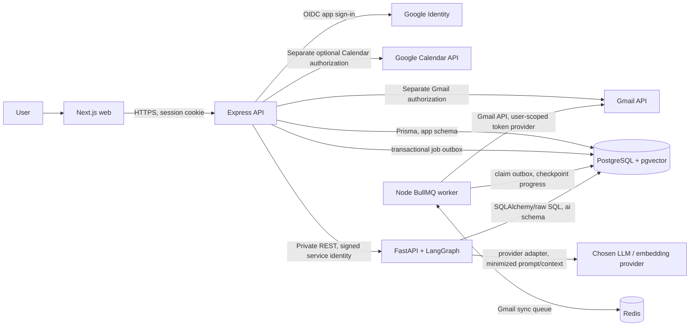

# MailPilot AI architecture

**Status:** Phase 1 foundation, Phase 3.2 data models, Phase 3.3 application authentication, Phase 4.1 Gmail OAuth, Phase 4.2 Gmail API client, Phase 4.3 email parsing/storage, Phase 4.4 bounded Gmail synchronization, Phase 5.1 provider-neutral LLM contracts/OpenAI adapter, Phase 5.2 structured email analysis, Phase 5.3 suggestion-only reply drafting, Phase 5.4 analysis UI/evaluation harness, Phase 6.1 embedding adapter, Phase 6.2 deterministic email chunking, Phase 6.3 pgvector persistence, Phase 7 retrieval/RAG, Phases 8.1-8.4 read-only LangGraph workflow/planning/tool routing/persistent checkpoint recovery, Phase 9 persisted approval lifecycle, Phase 11.1-11.2 source-linked tasks, Phase 11.3-11.4 Calendar connection and approval-gated event creation, Phase 12.2 user-memory management, and Phase 12.3 Node background jobs are implemented. Phase 12.1 documents the memory design. Calendar event creation is disabled by default. The frozen-set model baseline is pending provider configuration.

## Product scope

### MVP

- One signed-in user can connect one Gmail account and see connection and synchronization status.
- The user can request a bounded initial mailbox import, with a proposed default window of the most recent 90 days. The final message cap and retention period are open decisions.
- MailPilot stores normalized message and thread data, builds account-scoped hybrid search, and returns historical context with message-level source references.
- It extracts a summary, category/priority signals, action items, and possible deadlines into typed, reviewable records. Unknown dates remain unknown; inferred dates carry evidence and confidence.
- The user can ask for an editable reply draft for a selected thread. Drafts remain suggestions; Gmail sending is not implemented.
- It records user-visible task candidates and agent activity, can optionally connect a separate Google Calendar account, and supports creating an event only after approval of its exact proposal. Calendar event creation is disabled by default. MailPilot can recover a paused approved workflow.
- A scikit-learn text-classification baseline and a reproducible evaluation set are delivered before model-driven prioritization is treated as dependable.

### Non-goals for MVP

- Multiple mailbox providers, shared/team inboxes, delegated access, or multiple Gmail accounts per user.
- Autonomous sending, forwarding, archiving, deleting, labeling, or changing Gmail settings.
- Reading or indexing attachment contents, fetching URLs from message bodies, or rendering active email HTML. Attachment metadata may be stored for display.
- Calendar event updates/cancellations, task-manager integrations, browser extensions, mobile clients, or a general-purpose autonomous agent.
- Full historical import by default, realtime mailbox push, user-configurable model training, or cross-user learning.
- A separate vector database, a second agent framework, or more than the three application boundaries below.

## Assumptions and trade-offs

1. MailPilot is a multi-tenant web product. Every persisted object is owned by a user and usually scoped to a Gmail account. If this is initially single-tenant/internal, remove the SaaS-specific account and session assumptions before implementation.
2. The MVP reads Gmail with `gmail.readonly`. Sending is a later incremental authorization for `gmail.send`; no send scope is requested until the send feature is enabled. Google classifies these scopes and states that Gmail restricted-scope data stored or transmitted by a server requires additional verification/security assessment. Confirm Google verification and assessment obligations before real-user launch. See [Gmail API scopes](https://developers.google.com/workspace/gmail/api/auth/scopes).
3. PostgreSQL is the system of record. Prisma owns application-domain tables; the Python service owns its AI/index tables and checkpoint tables in a separate schema in the same database. This keeps ownership clear without creating another database service. Cross-schema foreign keys are optional; stable opaque IDs and account filters are required either way.
4. PostgreSQL is the source of truth for job intent and progress. Express writes a `JobOutboxEvent` in the same transaction as a Gmail sync run; a separate Node worker relays it to BullMQ/Redis and processes the job using the run's PostgreSQL checkpoints and lease. This is justified because bounded sync work can exceed one web request and should resume after interruption. Queue payloads contain only user/run/request identifiers. Queue delivery is at least once, so email upserts and sync checkpoints remain idempotent. FastAPI work remains behind the authenticated HTTP client boundary; Python does not depend on BullMQ or Redis queue internals.
5. The proposed initial sync window is 90 days, but its hard message cap and retention period need confirmation. OpenAI is the first LLM adapter and GPT-6.1 Sol is the initial evaluation candidate; the runtime model remains configurable. The embedding adapter defaults to OpenAI `text-embedding-3-small` at 1,536 dimensions. Production data-region/retention approval and the index version policy remain open. Adapters persist provider/model/version metadata; a model change that changes dimensions or vector semantics requires a separately versioned index and controlled re-embedding. See [LLM selection](llm-provider.md) and [embedding selection](embedding-provider.md).
6. Application identity uses Google OpenID Connect with only `openid email`. Gmail and Google Calendar authorization use separate client configurations and feature-specific scopes; signing in does not connect or authorize either provider. Calendar event creation uses the `calendar.events.owned` scope and is disabled by default.

## System context



The browser only calls Express for API data and mutations. Application sign-in uses Google OIDC identity claims only; Gmail and Calendar authorization are separate Google OAuth grants. The browser never receives provider tokens and does not call Gmail, Calendar, or the model provider. Express owns user authentication, Gmail OAuth/synchronization, the separate Calendar OAuth connection, approval records, and all external provider side effects. Calendar tokens are separately encrypted and never sent to FastAPI. FastAPI owns extraction, classification, chunking, embedding, hybrid retrieval, evaluation hooks, and graph execution. It never possesses Gmail or Calendar credentials. PostgreSQL is shared infrastructure, not a fourth application service; each application uses a separate database role and schema grants.

## User memory boundary (Phases 12.1–12.2)

The design is documented in [memory-design.md](memory-design.md). Express/Prisma now owns opt-in settings, saved memory, correction, expiry, source provenance, and per-user retrieval. Values are saved only after an explicit user action; email content cannot create or replace a value. The retrieval API returns at most 10 matches and 2,000 characters using deterministic lexical overlap after applying the authenticated owner predicate. Stale source revisions and expired items are excluded. Pause disables retrieval; turning memory off deletes the rows.

There is not yet an Express-to-FastAPI memory context integration. The retrieval UI is a preview, not a claim that email analysis or the LangGraph workflow uses saved memory. Any future runtime handoff must send only a small selected subset in transient context, label memory as data rather than instructions, and keep values out of checkpoints. Existing tasks, commitments, email evidence, and graph state are not memory and are never promoted automatically.

## Boundaries and monorepo layout

Use npm workspaces for TypeScript and `uv` for Python. Keep package contracts explicit and versioned; do not let the Python service import TypeScript implementation details.

```text
apps/
  web/                 Next.js UI; no Gmail or model secrets
  api/                 Express public API, future OAuth/sync/action gateway
  ai/                  FastAPI, LangGraph RAG workflow, retrieval/model adapters
packages/
  shared/              Shared TypeScript request/response schemas
prisma/                Prisma schema and migrations
docs/
  architecture.md
  api-contracts.md
  data-model.md
  security.md
  evaluation.md
  roadmap.md
```

Python models mirror the published JSON/OpenAPI contracts; they are not generated from private ORM classes. CI checks representative contract fixtures across both languages. `apps/api` has exclusive write ownership for `app` tables. `apps/ai` has exclusive write ownership for `ai` tables and read access only to the minimum account state needed for authorization, if any. Prefer sending normalized email events over granting broad raw-mailbox SQL access.

## Data flow

```mermaid
sequenceDiagram
  actor U as User
  participant W as Next.js
  participant A as Express
  participant G as Gmail
  participant DB as PostgreSQL
  participant F as FastAPI/LangGraph
  participant M as Model provider

  U->>W: Connect Gmail / request sync
  W->>A: Start OAuth or create sync (session, CSRF)
  A->>G: Authorization code exchange / Gmail API
  G-->>A: Tokens or mailbox page
  A->>DB: Encrypt refresh token; upsert messages + outbox
  A->>F: Outbox event: normalized message revision (idempotent)
  F->>F: Normalize, redact configured fields, chunk, embed
  F->>DB: Upsert chunks, vector, FTS text, extraction/index status
  U->>W: Ask for context or reply draft
  W->>A: Create run
  A->>F: Private run request with account, target IDs, request
  F->>DB: Hybrid retrieval constrained by account and filters
  F->>M: Minimized context for structured analysis/draft
  M-->>F: Structured output candidate
  F-->>A: Result or approval-required proposal with source refs
  A->>DB: Persist run, draft snapshot and pending approval
  A-->>W: Return result and approval card
  U->>W: Approve exact action or reject/edit
  W->>A: Decision with approval version
  A->>DB: Compare-and-set approval state and payload hash
  A->>F: Resume checkpoint with signed, scoped approval grant
  F->>A: Execute-action callback with approval ID + idempotency key
  A->>DB: Re-validate approval, scope, account, hash and duplicate state
  A->>G: Send only after all checks
  G-->>A: Gmail message result
  A->>DB: Record action result and audit event
  A->>F: Tool result; graph completes
  F-->>A: Completed run
  A-->>W: Final status
```

## Gmail synchronization and indexing

The first sync is bounded and paginated. It captures the Gmail profile history ID before listing messages, then checkpoints pages and message IDs in PostgreSQL. Store Gmail message/thread IDs, labels, internal timestamp, permitted sender/subject headers, normalized plain text, sanitized HTML, and attachment metadata only. Never fetch or persist attachment contents in MVP. The message body is untrusted input. The user-scoped email upsert is idempotent by connection and Gmail message ID. A transactional outbox creates a stable BullMQ job for each sync; the Node worker processes at most 20 batches of up to 25 messages per delivery and resumes from PostgreSQL checkpoints on bounded retries. The UI polls owner-scoped progress and can resume monitoring after a page reload.

Use Gmail `history.list` for incremental added, deleted, and label changes. Keep the old cursor until every page and message ID has been processed, and persist pending IDs so retried deliveries can repeat idempotent email upserts. A transient failure retains the current checkpoint. When Gmail returns 404 for an expired history ID, mark the run `resync_required`, preserve the old connection cursor, and let the user start a bounded initial sync. A fresh initial sync captures a new cursor and reconciles the newest messages within its cap; a subsequent incremental sync applies changes made during that scan. Push watch notifications are a later optimization. See [Synchronize clients with Gmail](https://developers.google.com/workspace/gmail/api/guides/sync).

The public API exposes start, active/progress polling, and cancellation endpoints. The browser cannot advance a batch directly. Gmail authorization remains `gmail.readonly`; synchronization performs no mailbox mutations. Redis and a live worker heartbeat are included in API readiness. See [sync API contracts](api-contracts.md#gmail-sync-behavior-and-resynchronization) and [background job operations](background-jobs.md).

Threading is a Gmail association, not a reason to concatenate a whole conversation into one embedding. Chunk each message independently with thread/message provenance. Retrieval filters must include account ID before ranking, and output citations identify the source message, thread, timestamp, and chunk. Combine PostgreSQL full-text search and pgvector ranking; only add reranking after the evaluation set demonstrates a measurable gain. See [ingestion and deletion details](data-model.md#ingestion-indexing-and-deletion).

## Agent workflow and control plane

### Phases 8.1-8.4 read-only RAG graph, planning, tools, and persistence

FastAPI runs the grounded answer path through a compiled `StateGraph`: `interpret_request` validates the typed request, `classify_intent` and `create_plan` create a bounded structured plan, and `validate_plan` checks the exact operation sequence against an allowlist before routing. The allowed intents are email search, summarization, action-item extraction, drafting, and task-candidate planning. Plans contain at most five steps and have no loop construct. Ambiguous or low-confidence requests stop for clarification before retrieval. The approved `gmail_search` tool performs owner-scoped hybrid search over synced Gmail data; `rag_answer` generates a grounded response from validated evidence. The tool registry validates Pydantic argument schemas, checks explicit per-tool read-only permissions, injects the trusted user ID separately from model arguments, applies bounded timeouts/retries, and returns sanitized structured errors. Search failures route to a safe abstention; empty or over-budget evidence also abstains. Both paths meet at `return_response`.

Plans can search emails, summarize evidence, extract action items, draft replies, or propose task candidates. Task plans can only propose candidates; they cannot create, complete, edit, or delete tasks. Drafting is classified and planned, then directed to the selected-thread reply-draft service; this graph does not generate or save a draft. Invalid model plans fail closed before retrieval or answer generation. The registry contains only read-only `gmail_search` and `rag_answer` tools; `gmail_search` queries the synced/indexed mailbox and does not call Gmail or handle OAuth tokens. The graph has no mailbox mutation tools, approval nodes, or send capability. Its PostgreSQL checkpointer stores per-run state in the AI-owned `ai` schema; an opaque thread hash incorporates the trusted owner, conversation ID, and run ID. The generated topology is shown in [rag-workflow.mmd](rag-workflow.mmd), and resume semantics are in [agent-workflow-persistence.md](agent-workflow-persistence.md).

The typed graph state contains request fields and stable IDs, the intent and allowlisted plan, retrieved sources/prepared evidence, a safe tool error code when needed, and the final grounded response. Checkpoints use an explicit deserialization allowlist; structured traces record node names only and never email content or reasoning. The classifier and planner receive the user request, not retrieved email bodies. Tool schemas omit user identity and reject extra arguments; the graph injects the trusted user ID from the signed internal request into every invocation and validates source ownership before answer generation. Prompts treat quoted email text as untrusted data, and schemas include no rationale or chain-of-thought field. Runtime services are injected through LangGraph context instead of state. The graph's output schema exposes only `GroundedAnswerResponse`; neither retrieved intermediate state nor private chain-of-thought is returned. Retrieved email text remains untrusted evidence and is handled by the existing grounded-answer prompt and citation validation.

### Later agent workflow and control plane

The full graph remains a bounded workflow, not an open-ended planner:

1. Validate the requested user/account/thread and run budget.
2. Load target thread summary and retrieve relevant historical chunks with metadata filters.
3. Extract structured fields and candidate tasks; attach evidence and confidence.
4. Compose an answer or reply draft with source references; validate the schema and recipient/thread consistency.
5. Produce a proposal only for a whitelisted action. Pause for a durable approval record tied to a canonical action hash.
6. On approval, execute through Express’s action gateway. FastAPI cannot call Gmail directly.
7. Persist citations, final result, model/evaluation metadata, and redacted trace identifiers.

### Planned versioned graph state

Use a typed, versioned state (Pydantic or `TypedDict`) with these logical fields:

| Field | Purpose |
|---|---|
| `runId`, `graphVersion`, `stateSchemaVersion` | Stable run/checkpoint mapping and safe migrations. `thread_id` is the stable run ID for resume. |
| `userId`, `accountId`, `targetThreadId`, `targetMessageIds` | Trusted, Express-authorized scope; never copied from an unchecked model tool argument. |
| `intent`, `userInstruction`, `requestLocale`, `timezoneHint` | User’s bounded request and interpretation context. |
| `retrievalFilters`, `retrievedSources[]` | Account-scoped search parameters and bounded source references (`messageId`, `threadId`, `chunkId`, sent time, excerpt, rank). |
| `extraction`, `answer`, `draftCandidate` | Typed, schema-validated work products with evidence and confidence. Unknown values remain null. |
| `proposedAction`, `actionPayloadHash`, `approvalId`, `approvalVersion`, `approvalDecision` | Exact action snapshot and approval handshake. The Express approval row remains authoritative. |
| `actionResult`, `status`, `safeErrorCode`, `retryCount`, `toolCallCount` | Idempotent execution result and bounded recovery metadata. |
| `providerModelVersion`, `promptVersion`, `retrievalConfigVersion`, `usage`, `traceId` | Reproducibility and operational measurement; usage can be null when not reported. |

The checkpoint may contain source excerpts, draft text, and user requests, so treat it as mailbox content: encrypt/protect database storage, restrict access, apply retention, and delete it with the run/account data. Do not put OAuth tokens, provider API keys, arbitrary model messages, or unbounded conversation history into graph state.

### Planned nodes, tools, and interrupt

Use explicit graph nodes: `validate_scope` → `load_target` → `retrieve_context` → `understand_or_draft` → `validate_schema_and_evidence` → `propose_action` → `approval_interrupt` → `execute_approved_action` → `persist_result`. Route schema failure to a bounded repair or a safe failure state; route missing context to clarification/abstention; route rejection/expiry to a terminal no-send state. Model/provider calls and graph/tool loops have configured time, token, and call budgets.

The only agent tools are `search_email` (account/date/sender/label filters required), `get_thread` (owned thread only), and `propose_reply` (pure draft creation). A requested send is represented as a typed proposal, not a model-executable Gmail tool. The graph pauses at a durable LangGraph interrupt and returns the exact action for Express to persist and render. After an Express-authenticated user decision, Express resumes the same checkpoint with a short-lived grant bound to the persisted approval, then the execution node calls Express’s single-action gateway. That gateway rechecks and executes; FastAPI cannot access Gmail tokens or choose additional side effects.

The Phase 5.1 adapter exposes typed text messages, optional JSON Schema constrained output, bounded output size, usage, and configured-rate cost estimates through a provider-neutral interface. The OpenAI Responses call is isolated under `apps/ai/src/mailpilot_ai/llm`; it applies timeouts/retries and sets response storage off. It does not provide agent tools. Future adapters must expose only capabilities confirmed for their selected model/API. See [provider and model selection](llm-provider.md).

### Phase 5.2 structured email analysis

Express exposes `POST /v1/emails/{emailId}/analysis` behind the application session and CSRF checks. It reads the email by authenticated owner, reuses an existing completed result for the same source revision/schema, sends bounded plain text and source metadata to the signed internal FastAPI analysis route, and persists successful results in Prisma's `app.analyses` table. The persisted row records source revision, analysis schema version, actual provider/model version, provider request IDs, usage, and validated output.

FastAPI asks the configured LLM adapter for JSON Schema constrained output derived from the Pydantic analysis types. It independently validates enum/size/date/event ordering constraints and confirms every evidence excerpt appears in the source email. Email fields are passed as JSON-encoded untrusted data with explicit prompt-injection boundaries. The model has no tools and cannot execute mailbox instructions or Gmail actions. Invalid or ungrounded output returns a safe error and is not persisted.

### Phase 5.3 reply drafting and evidence

Express exposes authenticated, CSRF-protected `POST /v1/emails/{emailId}/reply-drafts` and `PATCH /v1/emails/{emailId}/reply-drafts/{draftId}` routes. Generation loads the selected stored email and up to seven recent messages from the same owner-scoped Gmail thread, bounds the context, and sends it to FastAPI using the existing time-bound HMAC service boundary. The optional user instruction affects style only; email fields remain untrusted data.

FastAPI returns an editable plain-text suggestion, explicit uncertainty labels, and source message references for factual claims. Both services validate that claim text occurs in the draft and quoted evidence occurs in the referenced source message. Unsupported output is rejected. Insufficient context returns no draft and is not persisted. Suggestions live in the Prisma-owned `app.reply_drafts` table with source revisions and model metadata. Edits retain suggestion status. This phase adds no Gmail write scope, draft creation in Gmail, or send route.

### Phase 5.4 analysis integration and baseline evaluation

Express lists up to 50 recent owner-scoped email summaries without returning bodies, exposes saved analysis for the current source revision, and supports explicit same-revision re-analysis. The inbox UI keeps sample preview mail separate from stored mailbox messages and connects its analysis panel to these endpoints. It handles loading, empty, failure, retry, first-run, and re-analysis states and displays structured results with evidence excerpts.

The manually reviewed dataset is synthetic and versioned at `eval/email-analysis-v1.jsonl`. `apps/ai/scripts/evaluate_email_analysis.py` measures category precision/recall/F1, priority accuracy, exact action/commitment/event extraction, deadline candidate and date correctness, unmatched-claim rate, evidence-span support, latency, token usage, and configured-rate cost estimates. No live-model baseline was measurable in the current environment because `OPENAI_API_KEY` and pricing rates are not configured; record that baseline before making model-quality or launch claims.

### Phase 6.2 deterministic email chunking

FastAPI produces versioned chunks from one message at a time. Plain text is preferred, with deterministic HTML-to-text fallback, quoted-history cleanup, bounded character chunking, source offsets into normalized content, and a content hash. Chunks retain owner, application and provider message IDs, thread ID, source revision, timestamp, sender, and subject. Thread membership is provenance only: content from separate messages is never concatenated. The generator is pure and does not persist chunks or invoke embeddings; use `sourceRevision`, `contentVersion`, and `chunkerVersion` when persisting/replaying so changed source content or normalization rules regenerate the right chunks.

### Phase 6.3 pgvector storage

FastAPI owns `ai.chunk_embeddings_1536`; Prisma remains the sole owner of `app.email_chunks`. A composite owner/chunk foreign key cascades vector deletion with canonical chunk deletion. Each row stores source revision/hash/chunker version and provider/model/returned model version/dimensions/embedding-version metadata. The selected 1,536-dimensional index uses HNSW cosine distance plus owner/version B-tree filtering. Storage and query methods require a user ID; SQL repeats the owner predicate and PostgreSQL row-level security checks a transaction-local `mailpilot.user_id`. Queries join active current chunks and current emails and reject stale revisions. The model-version key prevents vectors from different model releases from mixing; changing dimensions requires a separately migrated vector table/index. AI migrations are ordered, transactional, and checksum-verified independently of Prisma migrations.

LangGraph checkpointing supports durable pause/resume through a persistent checkpointer and stable thread ID. A resumed node can run again from its start, so every pre-interrupt operation must be idempotent and external effects must be guarded by an Express-side approval check and idempotency record. See [LangGraph interrupts](https://docs.langchain.com/oss/python/langgraph/interrupts) and [persistence](https://docs.langchain.com/oss/python/langgraph/persistence).

## Operational recovery

- Gmail 401/revoked grant: mark connection `reauth_required`, stop mailbox jobs, keep UI data read-only until reconnection or deletion.
- History cursor expired: enqueue a bounded full resync and reconcile existing IDs rather than duplicating messages.
- Outbox delivery failure: exponential backoff with jitter, dead-letter after a bounded retry count, alert with event IDs only; replay is safe by `(accountId, messageId, sourceRevision)`.
- Provider timeout/rate limit: bounded retry only for idempotent generation/embedding calls; otherwise return a retryable run status. Never retry a send on uncertain outcome without looking up its action execution record.
- Invalid extraction/schema: one constrained repair attempt if supported by the configured adapter; otherwise persist an extraction failure and preserve the source email.
- Approval timeout or changed draft: expire the approval and require a new review. Rejection is terminal for that action.
- Database/checkpoint failure: do not claim completion. Resume from durable checkpoint/outbox state after recovery.

## Decisions intentionally deferred

Production provider data-region/retention approval and the embedding index/model-switch policy; Gmail scope verification timeline; user/account cardinality; initial import cap and retention; body redaction rules; SLOs and scale triggers for Redis/BullMQ; audit retention; production hosting/region; whether to persist an in-app draft as a Gmail draft; and the exact MVP label taxonomy. MVP drafts remain in MailPilot and can be sent only after approval.
