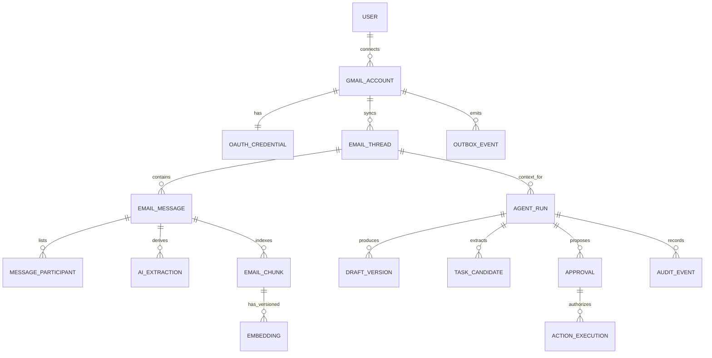

# MailPilot AI data model

**Status:** the Phase 3.2 Prisma projection, Phase 4.1 Gmail OAuth storage, Phase 4.3 parsed email storage, Phase 4.4 Gmail sync cursor/run storage, and Phase 5.3 suggestion-only reply draft storage are implemented; this document also describes planned later-phase entities. Prisma owns `app` tables; FastAPI owns `ai` tables and LangGraph checkpoint storage.

## Phase 3.2 physical ownership

Prisma owns the current `app` records for users, authentication identities, hashed sessions, Google connection metadata, source emails, versioned analyses, suggestion-only reply drafts, canonical email chunks, agent runs, pending actions, tasks, follow-ups, and audit logs. Their physical fields, indexes, compound ownership foreign keys, and deletion actions are defined in `prisma/schema.prisma`.

`GoogleConnection` stores provider identity and connection state, encrypted refresh-token material owned by Express, the committed Gmail history cursor, and initial-sync completion time. Phase 4.3 stores normalized source email content and sanitized HTML with attachment metadata only; it never stores attachment contents. Phase 4.4 stores resumable sync runs and page checkpoints in `GmailSyncRun`. A pending action stores its canonical payload and payload hash durably; approval and execution behavior remains future Express work. Audit metadata must remain minimal and must not contain email content, tokens, prompts, or provider responses.

Deleting a user cascades through identity, session, connection, email, analysis, reply draft, chunk, run, action, task, and follow-up rows. Deleting a connection or source email removes its dependent content and work items; deleting a run removes its pending actions and generated tasks. Audit rows survive user deletion with `userId` cleared.

Canonical email chunks live in `app.email_chunks`. Future Python-owned retrieval tables may store embeddings and retrieval indexes keyed by the opaque chunk UUID, but must not create a second `EmailChunk` table. Prisma and the Python migration tool continue to own separate tables. The chunker emits one message's cleaned body at a time; its offsets are Unicode code-point offsets into that normalized body. `sourceRevision` identifies the source message version, `chunkerVersion` versions the cleaning and chunk-boundary algorithm, and `contentHash` identifies the stored chunk text. The chunk-generation contract also emits `contentVersion` to identify the normalized content format. User, provider-message/thread, timestamp, sender, and subject provenance comes from the owner-scoped `Email` relation; the generator also includes these fields for safe handoff.

## Entity overview

## Application schema (`app`, Prisma)

| Entity | Key fields and constraints |
|---|---|
| `User` | `id`, normalized sign-in subject/email, timestamps, status. Do not make Gmail address the primary key. |
| `Session` | Hashed session identifier, user ID, expiry, revocation time, CSRF secret/hash as appropriate. Never store bearer tokens in browser-readable storage. |
| `GoogleConnection` | `id`, `userId`, provider subject/email, connection state, granted scopes, connected/disconnected and last-successful-sync timestamps, encrypted refresh token fields, committed Gmail history cursor, and initial-sync completion timestamp. Unique provider subject and user; Gmail cursor fields were added in Phase 4.4. |
| `GmailSyncRun` | User and connection owner IDs, `initial`/`incremental` mode, status, start and target Gmail history IDs, opaque page checkpoints, pending message IDs, bounded message cap, progress/failure counts, cancellation request, lease, and safe error code. A nullable unique active-connection key allows at most one active run per connection. History IDs and page tokens are internal state and are never returned by public progress endpoints. |
| `OAuthCredential` | One-to-one account relation; encrypted refresh token only, key version/nonce/tag, granted scopes, token update time, credential status. No plaintext refresh token in logs or general query results. Avoid persisting short-lived access tokens; acquire/cache in memory as needed. |
| `Email` | User/connection IDs, provider message/thread IDs, sender name and normalized address, decoded subject, plain text and sanitized HTML body, labels, metadata-only attachment records, body hash, received time, source revision, tombstone time. Unique `(connectionId,providerMessageId)` and tenant-scoped compound foreign key to its connection. Never persist attachment contents. |
| `Analysis` | User/email IDs, source revision, schema/model version, status, structured result, safe error code, and timestamps. Unique `(emailId,sourceRevision,schemaVersion,modelVersion)` and tenant-scoped compound foreign key to its email. |
| `ReplyDraft` | User/email IDs, source revision, schema version, provider/model, editable subject/body text, source message IDs/revisions, claim evidence, uncertainties, suggestion status, and edited flag. Tenant-scoped compound foreign key to its email; generation never sends mail. |
| `EmailChunk` | User/email IDs, source revision, chunker version, ordinal, character offsets, normalized text, content hash, status/tombstone time. Unique `(emailId,sourceRevision,chunkerVersion,ordinal)` and tenant-scoped compound foreign key to its email. Prisma owns canonical chunks; AI migrations must not create this table. |
| `MessageParticipant` | Message ID, role (`from`,`to`,`cc`,`bcc`), normalized address, display name. Restricted access; never use addresses as tenant keys. |
| `SyncJob` | Planned generic background sync entity; Phase 4.4 uses the durable, request-stepped `GmailSyncRun` model instead. |
| `OutboxEvent` | Event ID, account ID, aggregate ID, event type, source revision, attempts, next attempt time, lease, sent time, terminal error class. Store identifiers/version only; the Express worker loads the exact message revision from its owned mailbox table when dispatching. Unique event key prevents duplicate dispatch and avoids a second copy of email text in the outbox. |
| `AgentRun` | User/account/thread IDs, intent, request reference, status, graph version, checkpoint thread ID, provider/model/version metadata, latency/cost projection, safe error code, created/updated/finished time. Checkpoint content retention is a separate deletion obligation. |
| `DraftVersion` | Run/thread IDs, monotonically increasing version, canonical recipients/subject/body, reply message ID, payload hash, creation actor (`model` or `user_edit`), creation time. Encrypt or limit access to body; immutable after creation. |
| `TaskCandidate` | Run/source message IDs, title, description, due datetime or null, timezone/status, confidence, evidence references, review state, model/version, created time. Keep task extraction evidence and user correction history. |
| `PendingAction` | User/run IDs, action type, canonical payload and hash, idempotency key, decision state, payload version, expiry/decision times. Unique `(userId,idempotencyKey)` and tenant-scoped compound foreign key to its run. Never treat a graph checkpoint alone as authorization. |
| `ActionExecution` | Approval ID, action ID, idempotency key, immutable payload hash, state (`queued`,`executing`,`succeeded`,`failed`,`unknown_outcome`), provider message ID when successful, attempt metadata, safe result/error, timestamps. Unique idempotency key. |
| `Task` / `FollowUp` | User-owned task candidates and scheduled follow-up records with optional source email/run/task references, status, due time/timezone, confidence, and timestamps. Source and run links enforce the same user owner. These records do not schedule jobs or send messages in this phase. |
| `AuditLog` | Optional user, actor type, event/entity type and ID, request ID, timestamp, and minimal JSON metadata. User deletion sets the user reference to null so audit retention does not depend on cascading through user data. No full message, draft, token, or prompt content. Retention policy remains to be defined. |

Application tables should carry `userId` or `accountId` where authorization is required. Foreign keys and unique constraints are necessary but do not replace ownership checks in every Express query. Use cascade only where deletion semantics are explicit; provider data purge and audit retention cannot rely on blind cascading.

## AI schema (`ai`, Python service)

| Entity | Key fields and constraints |
|---|---|
| `IndexedMessage` | Account/message/thread IDs, source revision, sent time, sender/recipient normalized fields needed for filters, labels, body hash, status, indexed time. No duplicate source of truth for the complete raw email body unless needed by the chosen retrieval design. |
| `Embedding` | `ai.chunk_embeddings_1536` references `(userId,chunkId)` in Prisma-owned `app.email_chunks`; stores source revision/hash/chunker version, provider/model/returned model version, 1,536 dimensions, immutable embedding-version key, vector, and timestamps. Unique `(userId,chunkId,embeddingVersion)` prevents duplicate vectors while allowing model-version changes. AI migrations own only the vector table and `ai.schema_migrations`, not `app.email_chunks`. |
| Analysis output | The Express-owned `app.analyses` row is the durable result record. FastAPI returns validated results to Express; it does not migrate or write the Prisma-owned table directly. |
| Reply draft | The Express-owned `app.reply_drafts` row stores editable suggestion text, source message IDs/revisions, factual claim references/evidence, uncertainties, model metadata, and suggestion/edit state. FastAPI returns validated output; it does not write the Prisma-owned table. |
| `RetrievalTrace` (optional, privacy controlled) | Run/query ID, filters, returned chunk IDs and ranks/scores, retrieval config version, timing. Store query text only in a protected, short-lived evaluation/diagnostic setting, never as routine trace data. |
| `GraphCheckpoint` / checkpoint tables | Created by the selected LangGraph PostgreSQL checkpointer. Use a dedicated namespace/schema and configured TTL/deletion handling. Do not maintain a parallel hand-written copy of opaque checkpoint internals. |

`EmailChunk` metadata and full-text search plus versioned pgvector embeddings support owner-scoped hybrid retrieval in one PostgreSQL deployment. The initial 1,536-dimensional cosine HNSW index follows the selected embedding model; the vector table has an owner/version B-tree index and a composite owner/chunk foreign key with cascade deletion. Storage rejects incompatible dimensions and queries require an owner filter in SQL, enforce it again with row-level security, and verify the current chunk source revision/hash before returning results. Higher dimensions require a new table/index migration and full re-embedding. HNSW is approximate; filtered scans enable iterative scans, and recall/latency must be measured before adding further index tuning.

## Relationships and tenancy invariants

- A user owns a Gmail account; an account owns its mailbox mirror and all indexes derived from it.
- Gmail thread/message IDs are only unique within an account. All database keys and API lookups use `(accountId, providerId)` semantics.
- Chunk, extraction, task, draft, approval, run, and checkpoint data must be traceable back to the owning user/account and source messages.
- Retrieval always applies the account predicate before ranking, not only after candidate selection. Never search all tenants and filter the returned top-k in application code.
- Cross-service identifiers are opaque. FastAPI accepts `userId`/`accountId` from authenticated Express, and no browser-supplied identifier becomes trusted without Express authorization.
- Sources and extracted tasks reference stable message IDs plus chunk/evidence locations. If the message is deleted, its references become unavailable and dependent index rows are removed/tombstoned.

## Ingestion, indexing, and deletion

1. Express creates/upserts the `EmailThread` and `EmailMessage` and an `OutboxEvent` in the same transaction. A newer source revision supersedes older data; duplicate or stale revisions are ignored.
2. A worker claims an outbox event with a bounded lease, sends the normalized content to FastAPI, and marks it delivered after an acknowledged upsert. Retry uses the same event ID/revision.
3. FastAPI normalizes plain text; strips quoted history and signatures only when a deterministic, versioned rule can retain valid source offsets; otherwise preserve text with offsets. Chunk on message boundaries and bounded paragraph/character/token limits. Keep chunking version and hash so reprocessing is reproducible.
4. Write chunk records and FTS data. Call the configured embedding adapter in batches with explicit timeouts and size limits. Persist only vectors whose model/version and dimension match the index configuration. Upsert atomically by chunk and embedding version; failures leave an explicit `index_pending` status for retry.
5. At retrieval, apply account, date, thread, sender, and label filters as requested; retrieve vector and keyword candidates; fuse ranks with a versioned method; optionally rerank only after evaluation. Return references and scores, not unsupported claims.
6. On Gmail history deletion, mailbox disconnect, or user data deletion, Express first disables the account from sync, agent, and retrieval. It emits deletion/tombstone events. FastAPI marks rows inaccessible immediately, deletes chunks/vectors/extractions and related checkpoints, and acknowledges. Express then removes content, credentials, and remaining user-linked rows. Tombstones remain only long enough to reject delayed stale upserts. Deleting MailPilot’s copy does not delete Gmail messages.
7. Record completion and safe audit metadata. Define backup expiration and deletion SLA before production; deletion from live tables does not by itself remove already-created backups.

When `history.list` cannot continue from a stored Gmail history ID, run a full bounded reconciliation, not an additive import. Gmail documents that this can occur when the cursor is outside the available history range: [Gmail sync guide](https://developers.google.com/workspace/gmail/api/guides/sync).

The current resynchronization path starts another bounded initial run. It captures a fresh mailbox history cursor before paging, then upserts the newest messages within the selected cap. Existing rows outside that range are retained; the following incremental run applies the captured history changes. Message upserts and delete tombstones are owner-scoped and idempotent. A transient failure preserves the active cursor and message/page checkpoint for retry. Disconnect requests cancellation of an active sync before removing connection credentials.

## Migration and retention policy

Use Prisma migrations for `app`; AI migrations (Alembic or an explicitly selected migration tool) for `ai`; a single coordinated deployment gate verifies both against the same PostgreSQL version and pgvector extension. Never let both migration tools create or alter the same table. Keep model/chunk/index versions so re-embedding can happen alongside the current index and switch only after evaluation. Define retention/deletion schedules for raw mail, chunks, vectors, checkpoints, run results, and audit metadata before launch.
