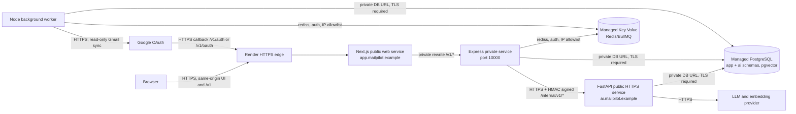

# Deployment architecture and runbook

Status: Render remains the first-hosted baseline. The repository now contains a Render Blueprint, CI workflow, protected deploy workflow, production configuration, and migration/recovery procedure; see the [CI/CD production runbook](ci-cd-production.md). This does not mean a Render workspace or production secrets have been configured.

## Decision

Use Render for the first hosted deployment, with all services and datastores in one Singapore region and one Render workspace. This keeps the app, worker, PostgreSQL, and Redis-compatible service in one managed platform, while supporting the current Node.js and Python runtimes, Next.js server rendering, background workers, and the required `pgvector` extension. Render's private network is available to services and datastores in the same region/workspace, and paid Postgres and Key Value plans provide the persistence features this app needs ([service types](https://render.com/docs/service-types), [private networking](https://render.com/docs/private-network), [Postgres extensions](https://render.com/docs/postgresql-extensions)).

The first production topology uses a public Next.js origin as the single browser and OAuth origin. Next.js path rewrites forward `/v1/*` to the private Express service. The API's AI calls go to a separate public HTTPS FastAPI origin because the current API production configuration requires `AI_SERVICE_URL` to use HTTPS; all model, retrieval, and tool routes remain HMAC-signed, and FastAPI receives no Gmail OAuth tokens. Redis uses its authenticated external `rediss://` URL with an IP allowlist because the current API configuration requires TLS for production Redis. PostgreSQL stays on its internal Render URL with TLS required. This is compatible with the current URL validation rules, while keeping Express and PostgreSQL off public ingress.

Render terminates public HTTPS at its edge. It forwards traffic to the web process, so TLS is not end-to-end from the edge to that process. Render's same-region private service URLs keep internal traffic off the public internet. PostgreSQL internal connections can also require TLS using `sslmode=require`; Render documents that its internal Postgres certificates are self-signed, so `verify-ca` and `verify-full` are not supported on the internal URL ([TLS certificates](https://render.com/docs/tls), [Postgres connections](https://render.com/docs/postgresql-creating-connecting)). If policy requires end-to-end TLS between every app process or private-only AI ingress, choose a VPC-based deployment with private TLS endpoints or complete the private-URL configuration changes listed below before launch.

## Options considered and starting cost

| Option | Fit and operating effort | Cost view |
| --- | --- | --- |
| **Render (selected)** | Lowest operational overhead for this stack. Managed Postgres, Key Value, web services, and workers share one platform and private network. A same-origin web proxy and a protected HTTPS AI endpoint are required by the current app URL rules. | Estimated **$89.20/month** for one small always-on environment at the plans below, before outbound bandwidth, domain, and model-provider usage. |
| Google Cloud Run + Cloud SQL + Memorystore | Stronger cloud-native IAM/VPC controls and native support for continuous worker pools ([worker pools](https://docs.cloud.google.com/run/docs/deploy-worker-pools), [Cloud SQL pgvector](https://docs.cloud.google.com/sql/docs/postgres/extensions), [Memorystore TLS](https://docs.cloud.google.com/memorystore/docs/redis/about-in-transit-encryption)). Higher setup effort: VPC connectivity, service identities, database and Redis networking/TLS, billing, and release orchestration. A current region-specific bill should be calculated before choosing it. | Higher and more variable baseline because managed PostgreSQL and Redis remain provisioned even when HTTP services scale down. Google Cloud requires a billing account for these managed resources. |
| One self-managed VPS with Docker Compose | Lowest likely invoice, but the team owns patching, firewalling, service supervision, Postgres/pgvector backups and restore, Redis persistence, TLS renewal, and incident recovery. | VPS price alone understates the cost of operating and recovering private mailbox data. Not recommended as the first production setup. |

The Render estimate uses one `0.5 CPU / 512 MB` plan each for Next.js, Express, and the Node worker ($7 each); one `1 CPU / 2 GB` plan for FastAPI ($25); one `0.5 CPU / 1 GB` Postgres plan ($19) with 15 GB provisioned storage (1 GB included and 14 GB additional at $0.30/GB, or $4.20); and one 1 GB Key Value plan ($20). That totals **$89.20/month** at the provider's published rates checked on **2026-11-25**. The Hobby workspace plan is $0/month; the estimate excludes outbound bandwidth above the 5 GB monthly allowance, custom domain fees if any, tax, and model-provider usage. Treat this as a starting estimate, not a quote: verify the [Render pricing page](https://render.com/pricing) when creating resources. Start with one instance per service, watch memory, database connections, queue depth, and latency, and resize before adding replicas. The smallest plans are for low traffic and may need to be increased quickly.

## Deployment diagram

The public app hostname must serve the UI and proxy API/OAuth paths to Express. Do not configure separate `app.example` and `api.example` browser origins with the current code: production validation requires `WEB_ORIGIN` and `API_PUBLIC_ORIGIN` to have the same hostname, and the session cookie is issued by Express. Configure Next.js rewrites (or an equivalent same-origin gateway) so that:

- `/v1/*` and `/health/*` go to the private Express service.
- `/` and `/api/health` remain on Next.js.
- The browser uses `NEXT_PUBLIC_API_BASE_URL=https://app.mailpilot.example`, so browser API calls remain same-origin.
- Google callback requests to `https://app.mailpilot.example/v1/.../callback` reach Express unchanged, including query parameters and cookies.

The hostname `ai.mailpilot.example` is a public TLS endpoint because the current API requires an HTTPS AI URL. FastAPI's application routes under `/internal/v1/*` require the existing timestamped HMAC signature. Keep provider calls and database reads behind that check; the public health routes must return only the existing content-free service status. Never add Gmail OAuth client secrets, session secrets, or token-encryption keys to FastAPI.

## Service layout

| Render service | Type | Initial size | Public access | Health check |
| --- | --- | ---: | --- | --- |
| Next.js | Web service | 0.5 CPU / 512 MB | `app.mailpilot.example` | `GET /api/health` |
| Express API | Private service | 0.5 CPU / 512 MB | None; reached by Next.js rewrite | `GET /health/live`; monitor `GET /health/ready` through the same-origin proxy |
| FastAPI AI | Web service | 1 CPU / 2 GB | `ai.mailpilot.example`, HMAC required for all `/internal/v1/*` business routes | `GET /health/live`; monitor `GET /health/ready` |
| Node worker | Background worker | 0.5 CPU / 512 MB | None | Monitor worker heartbeat through API readiness and worker logs |
| PostgreSQL | Managed Postgres | 0.5 CPU / 1 GB to start | Disable external access after provisioning; app services use internal URL | Provider database status plus app readiness |
| Redis | Managed Key Value | 1 GB paid plan | Authenticated external TLS URL with an allowlist for the API/worker regional egress ranges | Provider status; API readiness checks worker heartbeat |

Do not use the free database or in-memory free Key Value plan for production: the free Postgres plan expires and has no backups, and free Key Value loses its data on restart. Paid Key Value plans persist to disk; configure `noeviction` for the BullMQ queue. Redis is a transport, not the system of record. The PostgreSQL sync/outbox records remain the recovery source if queue state is lost ([free-plan limits](https://render.com/docs/free), [Key Value configuration](https://render.com/docs/key-value)).

Render's default outbound IP ranges are shared with other services in the same region. Use those ranges to allowlist the Key Value external endpoint, and revisit the list when Render reports routing changes. Dedicated outbound IPs are a separately priced Pro feature; avoid adding that fixed cost until external IP exclusivity is required ([outbound IPs](https://render.com/docs/outbound-ip-addresses), [dedicated IPs](https://render.com/docs/dedicated-ips)).

## Environment and secrets

Create separate **staging** and **production** Render environments. Each environment needs its own services, Postgres database, Key Value instance, OAuth clients, session/encryption keys, and AI provider key. Never use a production mailbox as staging data. Use a dedicated test Google account in staging and keep Calendar event creation disabled there and in production until the release/security gate explicitly enables it.

Set values per service using Render secret environment variables or an access-controlled environment group. Keep `.env`, database URLs, client secrets, API keys, encryption keys, service-signing secrets, and OAuth tokens out of GitHub, build logs, command-line arguments, and client-side `NEXT_PUBLIC_*` variables. Rotate secrets by staging the new value, deploying dependent services, verifying health, then removing the old value.

| Variable / setting | Next.js | Express | Worker | FastAPI |
| --- | --- | --- | --- | --- |
| `NODE_ENV=production` | Yes | Yes | Yes | — |
| `NEXT_PUBLIC_API_BASE_URL` | Public app origin | — | — | — |
| Private API rewrite target | Yes, server-side only | — | — | — |
| `WEB_ORIGIN` | — | Same public app origin | Same validated config if required at startup | — |
| `API_PUBLIC_ORIGIN` | — | Same public app origin | Same validated config if required at startup | — |
| `AI_SERVICE_URL` | — | Public HTTPS AI origin | Same validated config if required at startup | — |
| `DATABASE_URL` | — | Internal Postgres URL for the restricted app runtime role (`schema=app&sslmode=require`) | Same app runtime role | Never set in FastAPI |
| `AI_DATABASE_URL` | — | — | — | Internal Postgres URL for a separate restricted AI role (`sslmode=require`); no OAuth/session table access |
| `REDIS_URL` | — | Authenticated external `rediss://` URL | Same | — |
| `AI_SERVICE_TOKEN` | — | Secret HMAC key | Not needed by worker logic, but current shared API environment validation may require it | Same secret for signature verification |
| Google OAuth client IDs/secrets | — | OIDC, Gmail, and Calendar credentials as used by Express | Only the Gmail credentials and encryption values actually needed by the worker; current shared validation may require additional API settings | Never set |
| `SESSION_SECRET`, Gmail/Calendar token encryption keys | — | Express only | Only if current environment validation requires them; do not use them in worker code | Never set |
| `OPENAI_API_KEY` and AI settings | — | — | — | Yes |
| `GOOGLE_CALENDAR_EVENTS_ENABLED=false` | — | Yes | — | — |

Use Render's internal Postgres URL for app services and append `sslmode=require` while preserving the query parameters Prisma needs. For the API the URL must keep `schema=app`; the Python connection helper removes that Prisma-only option and keeps the TLS setting. Do not paste URLs into tickets or terminal output. Disable Postgres public access after migrations and operator access are complete; if an external maintenance client is needed, temporarily allowlist its trusted IP and remove it afterward.

## OAuth redirect URLs and TLS

Attach the production app domain to the Next.js web service and let Render issue/renew its managed certificate. Force HTTPS, use secure cookies, and set `TRUST_PROXY_HOPS` only to the number of trusted proxy hops observed by Express (never trust arbitrary forwarded headers). Keep the API callback origin equal to the app's browser origin.

Register these exact redirect URIs in the matching Google OAuth web clients for production; create different clients for staging:

- Sign-in / OIDC: `https://app.mailpilot.example/v1/auth/google/callback`
- Gmail read-only: `https://app.mailpilot.example/v1/oauth/google/callback`
- Calendar: `https://app.mailpilot.example/v1/oauth/google-calendar/callback`

Register the app origin `https://app.mailpilot.example` as the authorized JavaScript origin where Google requires it. The same-origin Next.js proxy must preserve the callback method, path, query string, transaction cookie, and response cookies. Do not add callback URIs with wildcards, localhost ports, or trailing-slash variants to production clients.

Public browser traffic and the public AI endpoint use HTTPS. Require TLS on the internal Postgres connection using `sslmode=require`; the API-to-AI request is HTTPS and HMAC-signed; Redis uses the external `rediss://` connection. The web/API path rewrite crosses Render's private network. Verify Render's current edge and private-network behavior during deployment; if internal process-to-process TLS is mandatory, do not treat a private hostname alone as equivalent to end-to-end TLS.

## Build, migrations, and release order

The Render service configuration is in [render.yaml](../render.yaml), and CI/deploy sequencing is in [the CI/CD production runbook](ci-cd-production.md). Do not use `npm run dev:all`, local `.env` wrappers, or development watchers as production start commands. The Blueprint keeps the monorepo root for Node services and uses `apps/ai` as the Python root so uv sees its `uv.lock`.

Production entrypoint details now configured in the repository:

- Express reads `API_PORT` (default `4000`), not Render's `PORT`; set `API_PORT=10000` for its private service.
- FastAPI defaults to `127.0.0.1` locally and reads `AI_HOST`; the Render Blueprint sets `AI_HOST=0.0.0.0` and `AI_PORT=10000` for health checks and network access.
- `apps/web` production start runs Next.js without loading the local `.env`; Render supplies `PORT` and the web server binds to `0.0.0.0`.
- The hosted web build uses `API_INTERNAL_HOSTPORT` to rewrite `/v1/*` and `/health/*` to the private Express service. Update the public origin and rebuild if the Render hostname changes.
- Supply only a non-secret placeholder `DATABASE_URL` to Prisma client generation at build time if the Prisma config requires it. Never put the production database URL into a build step.
- Confirm the compiled API and worker start from the generated `dist` output and that the Next.js build receives `NEXT_PUBLIC_API_BASE_URL` at build time.

Run migrations once per release from a trusted operator workstation before approving the GitHub production environment. The exact sequence, TLS requirements, secret handling, role separation, and commands are in [the CI/CD production runbook](ci-cd-production.md). Prisma owns `app`; only the Python migration tool writes the AI tables. Never attach migrations to web-service startup or allow two migration runs to race.

Migrations must be additive/expand-contract where rolling service versions overlap. Do not edit an applied migration or automatically roll back database DDL. If a release fails after migration, roll application services back to the previous compatible image and prepare a forward fix. The root documentation defines the migration ownership and ordering: [AI service migration notes](../apps/ai/README.md).

## Backups and recovery

- Use a paid Render Postgres plan. Render documents continuous PITR for paid instances: a 3-day recovery window on Hobby workspaces and 7 days on Pro or higher; PITR creates a new database for validation before cutover. Free Postgres has no backups ([backup and recovery docs](https://render.com/docs/postgresql-backups)).
- Create and download a logical export before risky schema releases, then retain an encrypted copy in an access-restricted backup location outside the application workspace. Render retains an on-demand export for seven days, so download it for longer retention.
- Perform a restore exercise at least quarterly into a separate database. Verify the `app` and `ai` schemas, pgvector extension, foreign keys, RLS policies, and migration history before any production cutover.
- Keep Redis paid and disk-backed with `noeviction`, but treat Redis as recoverable queue state. After a Redis reset, inspect nonterminal `GmailSyncRun` and `JobOutboxEvent` rows, then re-enqueue only through an approved recovery procedure that preserves idempotency. Do not delete the source outbox rows to clear the queue.
- Record backup age and last restore-drill date in the release checklist. Keep database dumps and mailbox data out of CI artifacts and developer machines.

## Operator runbook

### First deployment

1. Create a Render project/environment named `staging`; select one region (Singapore is the nearest listed Render region to India) and create paid Postgres and Key Value resources there ([Render regions](https://render.com/docs/regions)). Add the required Google OAuth redirect URIs for staging and restrict test consent to the dedicated test user.
2. Configure Postgres to use PostgreSQL 17 if available, enable `vector` with `CREATE EXTENSION IF NOT EXISTS vector;`, and verify the extension version supports the HNSW iterative scans used by the app. Render lists `pgvector` as supported ([extension list](https://render.com/docs/postgresql-extensions)).
3. Create Render services from the repository root: public Next.js web; private Express API; public FastAPI HTTPS endpoint protected by HMAC; one background worker. Keep all in the same region/workspace. Use separate build/start commands per service and configure the web rewrites described above.
4. Set environment values from the table. Use generated, independent secrets for each environment; use a 32-byte base64 Gmail encryption key and Calendar encryption key. Ensure `GOOGLE_CALENDAR_EVENTS_ENABLED=false`.
5. Configure Render's Key Value external access allowlist to include the API and worker outbound IP ranges for this region. Use the `rediss://` URL, confirm authentication is enabled, and set the queue's eviction policy to `noeviction`.
6. Run the single-run migration sequence above, deploy staging, and verify routes and health checks. Then test an OAuth sign-in, Gmail read-only consent/sync, AI analysis, task/source links, approval state transitions in dry run, and Calendar connection without creating events.
7. Repeat with separate resources and OAuth clients for production only after staging and release gates pass. Add the production custom domain, verify managed TLS, update Google redirect URIs, and confirm the public origin and cookie behavior through the proxy.

### Routine release

1. Review the diff, dependency changes, migrations, security notes, and offline evaluation changes. Run the repository's required lint, typecheck, test, build, and migration validation jobs in CI.
2. Take/confirm a current backup, run migrations once in the documented order, deploy compatible services, and wait for all readiness checks.
3. Verify `GET /api/health` on the public web origin; `GET /health/ready` on Express through the same-origin proxy; and both liveness/readiness endpoints for FastAPI. Confirm the worker heartbeat is fresh and the queue is draining.
4. Smoke-test sign-in and callbacks with a dedicated test user, verify that synced email is owner-scoped, and check that logs contain request IDs but no mailbox content or secrets.
5. Watch 5xx rates, request latency, AI/provider latency and token usage, DB connections/storage, Redis memory/connections, failed jobs, and worker heartbeat for at least one normal workload cycle. Roll back service images if health or correctness regresses; do not reverse an applied migration automatically.

### Incident and recovery

- **Web/API unavailable:** check Render deploy/health status and logs by request ID. Confirm the same-origin rewrite target resolves privately and Express is listening on `API_PORT=10000`; test `/health/live` before `/health/ready`.
- **AI errors:** verify `AI_SERVICE_URL` is the HTTPS AI origin, the API/AI HMAC secrets match, and the AI signature middleware is rejecting unsigned calls before provider work. Check provider quota and latency without logging request bodies.
- **Redis/worker unavailable:** verify the `rediss://` URL, Key Value allowlist, memory usage, `noeviction`, worker service status, and heartbeat. After queue loss, reconcile DB outbox/sync state and re-enqueue idempotently; retain failed/dead-letter evidence.
- **Database unavailable or bad migration:** stop further releases, preserve logs/request IDs, initiate PITR to a new database at the last known good time, validate it in isolation, update service database references only after verification, then retain the old database until cutover is confirmed.
- **OAuth callback failure:** compare the exact callback URL in Google Cloud with the public origin/path, check the Next rewrite and `API_PUBLIC_ORIGIN`, verify same-site secure cookies and proxy trust, then inspect safe callback error codes. Never log OAuth `code`, state, or cookies.

## Before production: repository readiness gates

The repository config does not mean production is ready for real mailbox data. These operator and release gates remain:

1. Provision separate runtime roles and URLs before production: API/worker use the app runtime `DATABASE_URL`; FastAPI uses its distinct `AI_DATABASE_URL`. Restrict AI access so it cannot read Google credential/session tables. Use migration-only identities from the operator procedure; do not put these credentials in Render service variables. Verify grants/RLS before production mailbox sync.
2. Configure separate OAuth clients and exact callback routes for staging and production. Verify production Google consent-screen publishing, Gmail scope review/verification requirements, and account deletion/revocation before onboarding users.
3. Add and test a recovery command for redispatching eligible nonterminal sync outbox work after Redis loss. The database is durable, but the current outbox's normal relay marks jobs dispatched; Redis queue loss needs an operator reconciliation step.
4. Exercise deployment, migration, restore, callback, proxy-cookie, and service-failure flows in staging and record results against [release gates](release-gates.md). Keep real email writes and Calendar event creation disabled until their separate approval/scope/security gates pass.

