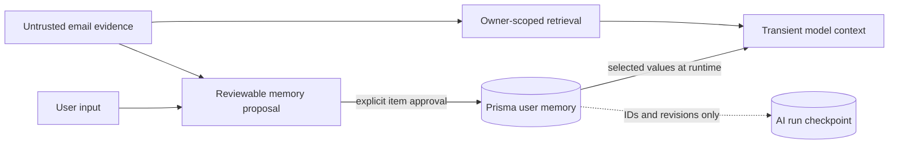

# Phase 12.1 — User memory design

**Status:** this document is the Phase 12.1 design baseline. Phase 12.2 implements owner-scoped Prisma storage, consent/settings, explicit user entry and correction, email provenance, expiry, deletion, and bounded lexical retrieval. The proposal-generation/model-context portions below remain design guidance; they are not active behavior.

## Phase 12.2 implementation notes

- Express owns `app.user_memory_settings` and `app.user_memories`; FastAPI and LangGraph do not read or persist memory values.
- The Settings UI provides opt-in, pause, turn-off-and-delete, inspect, edit/correct, confirm expiry, and per-item deletion. An explicit form submission creates an approved value. No email extraction or model proposal writes memory.
- A user may attach an owned synced email as provenance while manually entering the value. The source relationship cascades on hard deletion. A newer source revision or soft deletion makes the memory stale and unusable until the user reviews and saves it again.
- Retrieval filters by authenticated owner and enabled mode before lexical scoring. It returns at most 10 distinct items and 2,000 serialized item characters, including provenance metadata. It is currently a UI preview; it does not personalize analysis or enter model prompts/checkpoints.
- Memory keys are unique by owner/type. Conflicts return an error and require an explicit edit of the existing item. Corrections replace the current value; audit records contain operation metadata only.
- Expired entries are unusable immediately and are lazily hard-deleted after 30 days on memory API access. Recurrence and source metadata are retained, but email quotes/bodies and evidence digests are not copied into memory rows.

## Goals and invariants

User memory is a small, account-scoped set of information that a person has deliberately saved for reuse. It is not a second mailbox archive, an inferred user profile, a task list, or model-owned long-term state.

- Memory is off by default. Gmail connection, email analysis, a model response, and email text containing “remember this” do not grant consent.
- The user opts in to memory use and storage, then approves each proposed item. A memory explicitly entered and saved by the user counts as item approval.
- Only approved, active items may be retrieved for later runs. A model score, repeated email, or graph checkpoint never activates or renews memory.
- Every item belongs to exactly one MailPilot user. Express derives the owner from the authenticated session and enforces the owner predicate on every read, write, correction, and deletion.
- Retrieved email text remains untrusted, source-linked evidence. It cannot set policy, create memory, approve a proposal, or cause an external action.
- Memory cannot authorize Gmail, Calendar, task, or other external side effects. Those operations continue to require their separate approval flow.
- Do not infer or store sensitive traits from mailbox content. Sensitive categories such as health, race or ethnicity, religion, sexual orientation, political beliefs, disability, biometrics, and precise location are excluded from model-generated memory proposals. Supporting these as user-authored memories would require a separate privacy and product review.

## The three data planes

| Data | Purpose and authority | Persistence and reuse |
|---|---|---|
| Approved user memory | Small set of user-confirmed preferences, recurring commitments, and useful non-sensitive facts. The user is the authority. | Durable `app` data, owner-scoped and expiry-bound. Reused only when memory is enabled and the item is relevant to the current request. |
| Agent-run state | Request interpretation, plan, node results, tool IDs, and recovery metadata for one run. The run is not a profile. | Existing AI-owned checkpoint state with the configured run retention/TTL. Never promoted to memory automatically. Memory text is excluded from checkpoint state; store only opaque memory IDs and versions there. |
| Retrieved email content | Original source material and citations for the current answer or extraction. Email is untrusted evidence, not user intent. | Existing owner-scoped email and index stores, subject to mailbox retention/deletion. Retrieval for one run does not add or renew a memory. |

Express/Prisma should own durable `app.user_memories`, consent settings, and any reviewable proposals. FastAPI should not access the memory table or Gmail credentials. For a model call, Express should resolve only the selected active memories and pass them as runtime-only context through the authenticated internal boundary. The graph checkpoint stores IDs and revisions, not copied memory text. If a resumable workflow cannot keep memory values out of persisted state, do not provide memory to that workflow.

## Memory types and proposed record

Keep the taxonomy narrow and explicit:

| Type | Suitable examples | Exclusions |
|---|---|---|
| `preference` | Preferred reply tone, language, or ordinary work-hours display timezone. | Sensitive-trait guesses, policy overrides, or instructions to bypass approval. |
| `recurring_commitment` | A user-confirmed recurring responsibility with a bounded recurrence rule, owner, and timezone. | One-off tasks, inferred availability, or an obligation found only in an email without user confirmation. |
| `relevant_fact` | A concise, non-sensitive fact the user asks MailPilot to remember for later work. | A copied email, full conversation, secret, credential, or sensitive personal trait. |

Use type-specific values rather than unrestricted JSON: preferences use an allowlisted key (for example, reply style, response language, or display timezone) and an enum/validated short value; recurring commitments use a bounded label, explicit owner, structured recurrence, timezone, and optional end date; relevant facts use a short key and value capped at 300 characters. No type accepts a transcript, secret, provider credential, executable instruction, or rule that can bypass policy or approve an external action.

Proposed `UserMemory` fields:

| Field | Meaning |
|---|---|
| `id`, `userId` | Opaque memory ID and mandatory owner ID. |
| `type`, `key`, `value` | Allowlisted type, normalized per-user key, and bounded typed value. Use a type-specific schema; do not accept arbitrary model JSON or long free-form notes. |
| `sourceKind` | `user_entered`, `email`, or `commitment`. A user-entered item has no email source; an email-derived item requires an owned source message/revision; a commitment-derived item requires an owned source `Commitment`. |
| `sourceEmailId`, `sourceThreadId`, `sourceRevision`, `sourceCommitmentId` | Optional owner-scoped provenance with a database-enforced source relationship. For a commitment source, retain its commitment ID and the underlying email/thread/revision. |
| `evidenceDigest`, `evidenceOffsets` | Optional digest and offsets for the excerpt reviewed by the user. Do not duplicate the email quote/body in the memory row. Resolve the excerpt from the current owned source when showing a proposal. |
| `sourceObservedAt`, `capturedAt`, `approvedAt`, `lastConfirmedAt` | Source message/task timestamp when applicable, when MailPilot captured it, when the user explicitly approved it, and when the user last reconfirmed it. |
| `confidence`, `confidenceBasis` | Optional bounded extraction confidence and its basis (`model_evidence` or `user_asserted`). User assertions may have a null score. Confidence is informational only; it never substitutes for approval. |
| `validFrom`, `expiresAt` | Optional start and required default expiry. Local recurring times require an IANA timezone. |
| `revision`, `consentVersion`, `status`, `createdAt`, `updatedAt` | Versioned correction, the consent disclosure accepted for the item, and lifecycle metadata. Status is `active`, `stale`, or `expired`; explicit deletion removes the record. |

Only one active item per `(userId, type, key)` should be allowed. Similar wording must not be silently merged: show possible duplicates during review and let the user replace or retain items. Recurring rules should use a small structured recurrence schema (interval, frequency, selected weekdays/month days, timezone, and optional end date), not executable cron or model-generated instructions.

### Review proposals

An email-derived candidate is a `MemoryProposal`, not a `UserMemory`. It has an owner, exact proposed type/key/value, source reference and revision, optional confidence, consent version, snapshot hash, creation time, and a short expiry (seven days). Its states are `pending`, `approved`, `rejected`, `expired`, and `withdrawn`. It is never used to personalize a response while pending. Approval binds to the displayed proposal hash. Editing a proposal invalidates that hash and requires review of the edited value. Rejection does not create a memory.

Proposals are generated only when the user has opted in. Email text can supply evidence for a proposal, but only a user action in MailPilot approves it. A direct “remember this” request may open the same review/save flow; email content itself cannot invoke that operation. Initial limits should cap each user at 50 active items and each model call at 10 selected items/2,000 characters total; requests exceeding the per-user cap require deleting or replacing an item first.

When a proposal is approved, promote its exact approved value to `UserMemory` and remove the value and evidence locator from the proposal row, retaining only status, owner, timestamps, and snapshot hash for audit/idempotency. Rejection or expiry deletes the proposed value/evidence immediately and removes remaining proposal metadata within 30 days. A user's withdrawal deletes pending proposals at once.

## Consent and controls

1. Initial mode is `disabled`; there is no silent memory collection during onboarding or mailbox sync.
2. Enabling memory requires clear consent describing the three supported types, that approved items may be sent as limited context to the configured model provider, the expiration defaults, and how to review/delete items.
3. Consent to the feature permits proposing eligible items; it does not approve individual extracted content. Every proposed item still needs a separate explicit approval.
4. Users can inspect active and expired items, source, approval date, confidence basis, and expiry. They can disable future proposals/use, edit an item, confirm it again, or delete one/all items.
5. “Pause” immediately stops proposal generation and memory retrieval but keeps saved items only until their existing expiry. “Turn off and delete” withdraws consent and immediately deletes saved items, proposals, and derived memory caches. Re-enabling requires a new consent action.

Consent is a revocable setting, not a waiver for model use. The consent text must be versioned and its accepted version/time recorded. Material changes to memory purpose, model-provider use, or retention require renewed consent before any memory is sent to a model. Do not put consent decisions in model prompts or allow model output to change them.

The later schema should use one owner-scoped `UserMemorySettings` row with `mode` (`disabled`, `enabled`, or `paused`), `consentVersion`, `consentedAt`, and `updatedAt`. The default row/mode is `disabled`. Store mode changes transactionally and write a content-free audit event; never infer consent from an API call or existing mailbox grant.

## Correction, expiry, and deletion

- A correction is saved as a new reviewed revision. The UI shows the exact replacement value and source. Update the row in place and remove the old value; retain only a content-free audit event and hashes needed for proposal integrity, not a history of prior text. Replacing the same type/key follows the same rule.
- A source-derived item becomes unavailable for retrieval when its email revision changes or its source is deleted. Require the user to approve a refreshed candidate or enter the value directly; never silently refresh from new email text.
- An email-derived memory has a restrictive owner-scoped source relationship with cascade deletion. Deleting the source email/mailbox copy (including through a mailbox data purge) or deleting the user removes the memory and pending proposal; merely disconnecting Gmail does not delete retained mailbox data or its memories. If the user wants to keep a value independently, they must re-enter it as `user_entered` and approve it after seeing that it will no longer depend on the source email.
- Memory expires unless reconfirmed. Defaults: preferences expire 365 days after user confirmation; recurring commitments expire 90 days after confirmation or at their explicit recurrence end, whichever comes first; relevant facts expire after 90 days. The user may choose an earlier date. Passive email activity and model confidence never extend expiry; explicit reconfirmation sets a new `lastConfirmedAt` and expiry.
- Expired items stop being retrieved immediately and are hard-deleted within 30 days. The owner may delete sooner. Deletion removes search/cache copies and any run-scoped runtime context; checkpoints contain only IDs and versions, so no durable memory value remains there.
- Account deletion hard-deletes memory, proposals, consent settings, and derived cache/index rows. Backups follow the documented backup expiration policy. Audit rows may retain a content-free deletion event with no memory value or source quote.
- A correction or deletion request is owner-authenticated and CSRF-protected. Foreign or missing IDs return the same not-found response.

## Use, attribution, and safety

Select only a small number of active memories relevant to the current user request, with deterministic limits on count and bytes. Enforce `userId` in SQL before ranking. Do not load another account’s records, use raw email-body similarity as permission, or send a full memory inventory to the model. Memory remains a personalization hint or a user-confirmed fact, not an instruction hierarchy: it cannot override system/developer rules, consent, approval, tool allowlists, or the current user’s request.

When an answer relies on a memory, label it as saved memory and expose its item/source reference. If the answer needs a verifiable historical fact, retrieve and cite the source email as well; the memory row is not a substitute for the original source. If a source is unavailable or stale, abstain from treating its memory as evidence.

Logs and traces contain opaque memory IDs, operation, status, and request ID only. Exclude values, source quotes, prompts, and provider responses. Audit consent changes, proposal decisions, corrections, reconfirmations, expirations, and deletions with content-free metadata.

## Remaining implementation gates

Before connecting retrieval to an AI workflow, add a transient-only memory context handoff with explicit purpose consent, provenance citations, and strict checkpoint non-persistence. Add tests for cross-user access, owner-bound email provenance, correction/conflicts, stale source, expiry, deletion, consent withdrawal, retrieval limits, and the fact that memory cannot alter agent policy. Do not add embeddings or complex ranking until a measured retrieval need exists. Do not train on memory data.
